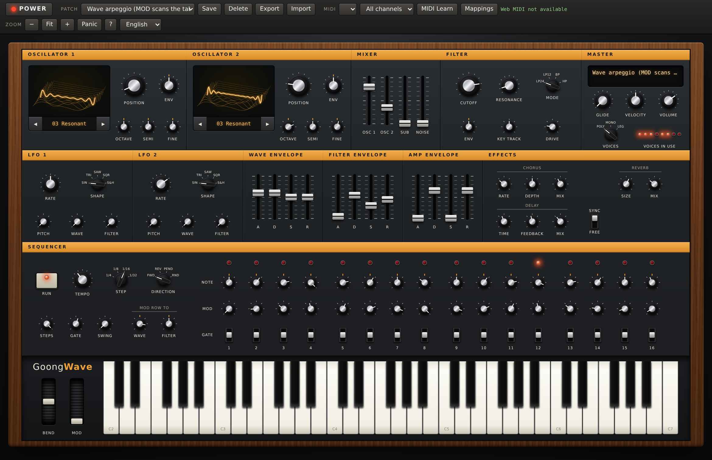

# GoongWave — web wavetable synthesizer with an analog-style step sequencer



A traditional (non-modular) polysynth: 8 voices, two wavetable oscillators per voice, a 4-pole filter, three envelopes, two LFOs, chorus/delay/reverb and a 16-step sequencer with one knob per step. Static web app with no dependencies and no build step (AudioWorklet + Web MIDI). Sibling of [Goong55](https://github.com/glopgar/goong55).

## Running it

```bash
python3 serve.py
```

Then open <http://localhost:8056/> in Chrome, Edge or Firefox. Audio and MIDI require `localhost` or HTTPS, so opening `index.html` as a file does not work.

```bash
node test/render.mjs
```

Offline engine tests: wavetable band-limiting, tuning, aliasing, filter, envelope timing, voice allocation, the sequencer, and every factory patch (each must sound, not clip, and fall silent). `test/browser.html` is a self-test of the panel, to open from the running server.

## Using it

- **Knobs and sliders**: drag up/down or use the wheel; Shift for fine adjustment; double-click resets. The Master display shows the value.
- **Oscillators**: each scans one of 15 wavetables. Pick the table with ◀ ▶ and move through it with *Position*; *Env* lets the wave envelope sweep it, and the LFOs and the sequencer's Mod row can move it too. The display shows the table and the wave being played.
- **Sequencer**: *Run* (or Space) starts it. Each step has a note knob (±12 semitones), a Mod knob and a switch: down = rest, centre = note, up = tie into the next step. *Mod row to* sends the Mod row to the wave position and the filter cutoff. While it runs, the keys transpose the sequence (C3 = as programmed).
- **Voices**: POLY, MONO, or LEG (mono without retrigger; glide only between tied notes — with sequencer ties this gives slides).
- **Keyboard**: on-screen keys (lower on the key = louder), computer keys (`A W S E D F T G Y H U J K`, `Z`/`X` for octave) or MIDI (notes, pitch bend, mod wheel = LFO 1 vibrato, sustain pedal). Right-click a control for *MIDI learn*.
- **Patches**: 20 factory patches, plus save, export and import as JSON. Interface in Spanish or English.

## Structure

| File | Contents |
| --- | --- |
| `dsp/wavetables.js` | The wavetables, computed from formulas, with band-limited copies of every wave |
| `dsp/params.js` | The parameter list shared by engine, panel and tests |
| `dsp/engine.js` | Voices, filter, envelopes, LFOs, sequencer and effects |
| `dsp/worklet.js` | AudioWorklet wrapper |
| `js/defs.js` | Panel layout and value read-outs |
| `js/ui.js` | Drawing of the panel, wavetable displays and keyboard |
| `js/midi.js` | Web MIDI and control mapping |
| `js/presets.js` | Factory patches |
| `js/i18n.js` | Interface strings |
| `js/main.js` | Application state, audio start-up, toolbar |

## How it sounds the way it does

- **Wavetables** are rows of 33–65 single-cycle waves of 2048 samples, built by additive synthesis or by FFT of a formula (sync, FM, wavefolding, phase distortion, formants…). No sampled or third-party wave data is used. Each wave is stored at 11 band-limits; the oscillator picks the one whose top harmonic fits the pitch and crossfades between neighbouring waves, so scanning is smooth.
- **Voices** run at twice the output rate and are decimated, so the filter's saturation does not alias.
- **Filter**: 4-pole ladder with zero-delay feedback and one saturator in the loop; LP24, LP12, BP and HP by mixing the poles. It self-oscillates in tune.
- **Sequencer** runs inside the audio engine, so its timing does not depend on the page.
